# BIT 4131 Statistical Computing and Reporting

## Introduction

I used a reproducible synthetic dataset with 1,200 rows to demonstrate the methods below. It is made-up practice data, not real student records, so the results do not describe actual students or teaching. The Python script creates the shared dataset. The R script reads the same file. I set the random seed to 4131 so the examples can be repeated.

## 1. Measures of centre and spread

The mean is the total divided by the number of values. The median is the middle after sorting. The sample standard deviation describes spread around the mean. For scores, I got a mean of 59.19, median of 58.86, mode of 57, sample variance of 91.30, and sample standard deviation of 9.56. The first and third quartiles were 52.91 and 65.88. The mean and median are close, and the score skewness is 0.07, so the scores are roughly symmetric.

**Worked example:** For 2, 4, and 6, the mean is $(2+4+6)/3=4$ and the median is 4.

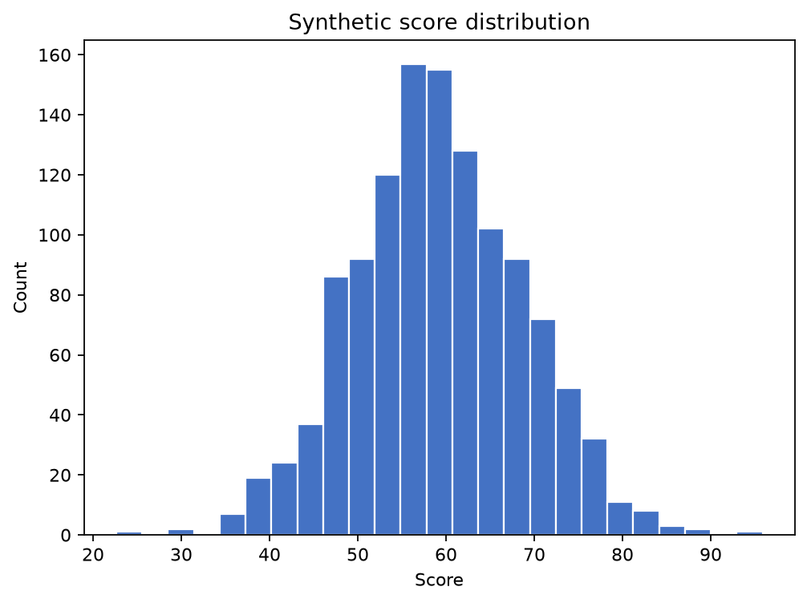
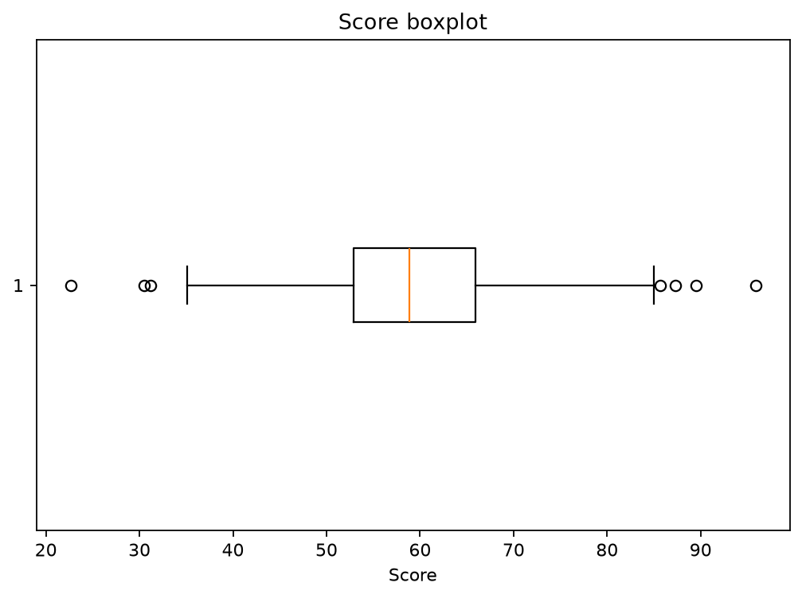
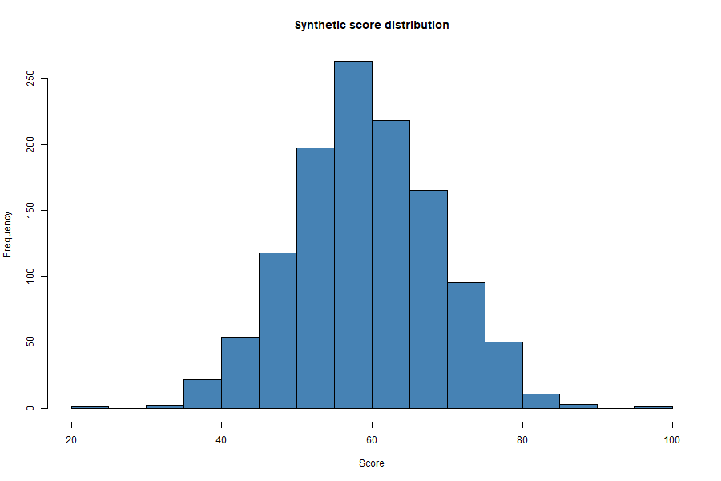

## 2. Probability

For events $A$ and $B$, conditional probability is $P(A\mid B)=P(A\cap B)/P(B)$. The generated pass rate was 83.6%; among rows marked Workshop it was 89.0%. In 100,000 simulated pairs of coin tosses, the estimated chance of two heads was 0.248.

**Worked example:** If 3 of 5 students pass, the estimated pass probability is $3/5=0.6$.

## 3. Probability distributions

For a binomial variable, $P(X=k)=\binom{n}{k}p^k(1-p)^{n-k}$. With $n=10$ and $p=0.5$, the probability of exactly 6 successes was 0.205, and the probability of 6 or fewer was 0.828. Using the generated score mean and standard deviation as the fitted normal parameters, the probability within one standard deviation of the mean was 0.683. This normal curve is a reference model, not proof that the scores are normally distributed.

**Worked example:** For one fair coin toss, $P(\text{head})=1/2=0.5$.

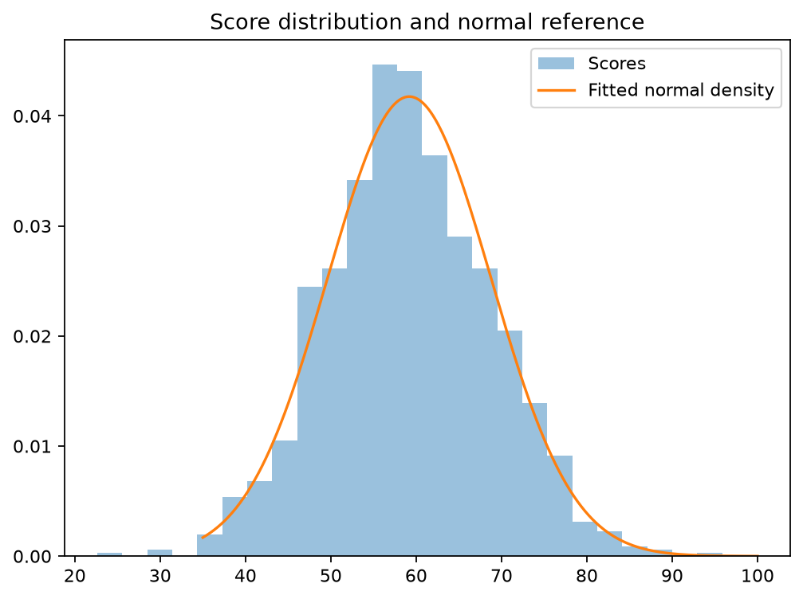

## 4. Sampling distributions and the Central Limit Theorem

The standard error of a sample mean is approximately $\sigma/\sqrt{n}$. I drew 2,000 samples of 40 values from a simulated population. The standard deviation of their means was 1.925; the theoretical standard error was 1.900.

**Worked example:** If a population standard deviation is 12 and the sample size is 36, the standard error is $12/\sqrt{36}=2$.

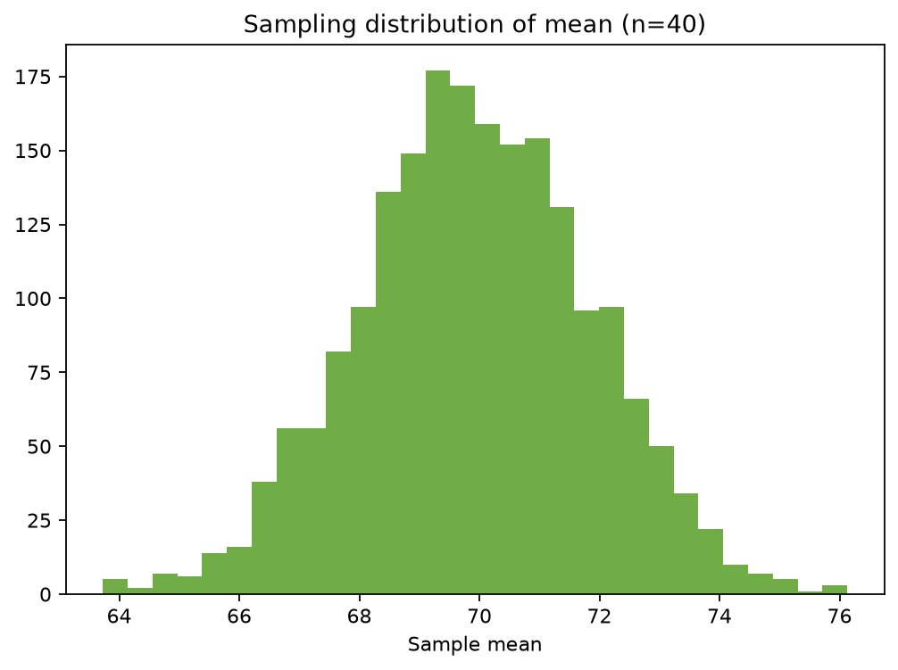
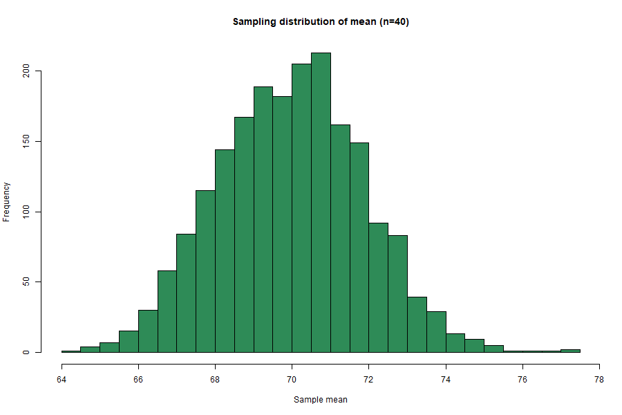

## 5. Confidence interval

A 95% t interval for a mean is $\bar{x}\pm t^*s/\sqrt{n}$. For the generated scores, the interval was 58.65 to 59.73. It gives a range of plausible values for the mean under the sampling assumptions.

**Worked example:** For a sample mean of 10, sample standard deviation $s=4$, and $n=16$, with $t^*=2.131$ at 15 degrees of freedom, the margin is $2.131\times4/\sqrt{16}=2.13$. The interval is $[10-2.13,10+2.13]=[7.87,12.13]$.

## 6. Hypothesis test

Welch's two-sample t-test compares two means without assuming equal variances. The generated Workshop mean was 60.95 and the Control mean was 57.50. The test statistic was 6.37 and the p-value was $2.64\times10^{-10}$, below 0.05, so I rejected equal means for this generated sample. This is not evidence about a real workshop.

**Worked example:** If a test gives $p=0.20$ and the chosen level is 0.05, I do not reject the null hypothesis because $0.20>0.05$.

## 7. Correlation and covariance

Correlation describes the direction and strength of a linear relationship, from -1 to 1. For complete rows, score correlation was 0.397 with study hours and 0.238 with attendance. The sample covariance of score with study hours was 13.11, and with attendance it was 28.03. Correlation alone does not show cause and effect.

**Worked example:** If two values rise together in pairs (1,2), (2,4), and (3,6), their correlation is 1.

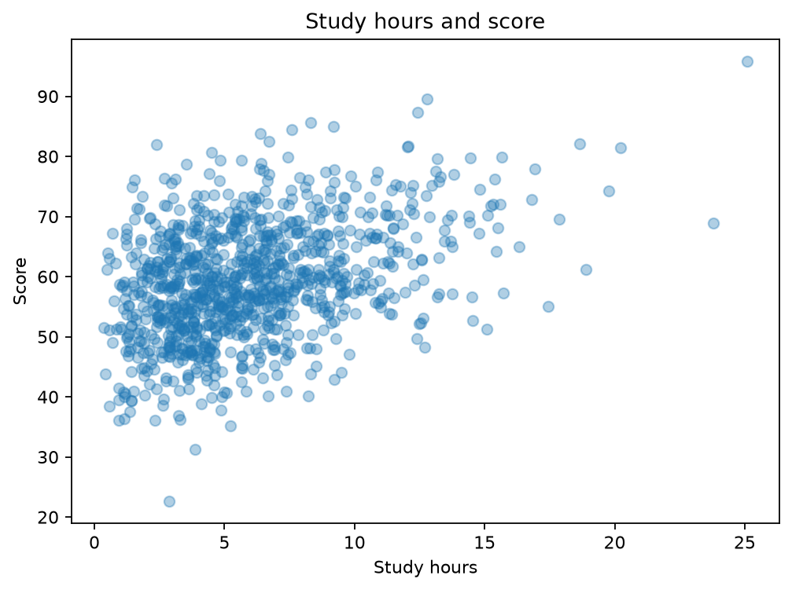

## 8. Linear regression and least squares

Least squares chooses coefficients to minimize $\sum_i(y_i-\hat{y}_i)^2$. I fitted score using study hours, attendance, treatment, and category. For the 1,014 complete rows, the fitted equation was $\text{score}\approx35.60+1.118(\text{hours})+0.191(\text{attendance})+3.31(\text{Workshop})+2.46(B)-1.59(C)$. The model's $R^2$ was 0.284. The category terms compare B and C with A, and Workshop with Control. These are relationships in synthetic data.

**Worked example:** For the line $\hat{y}=2+3x$, when $x=4$, the predicted value is $2+3(4)=14$.

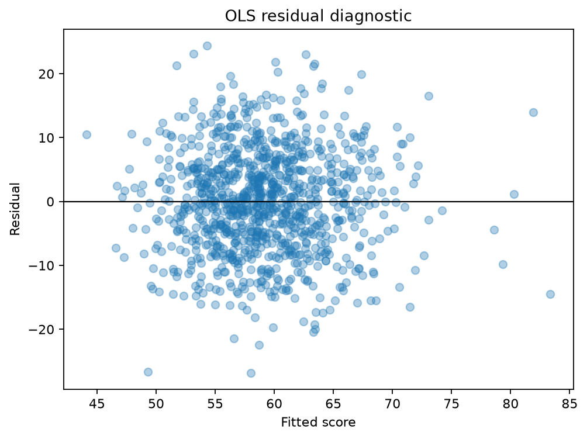
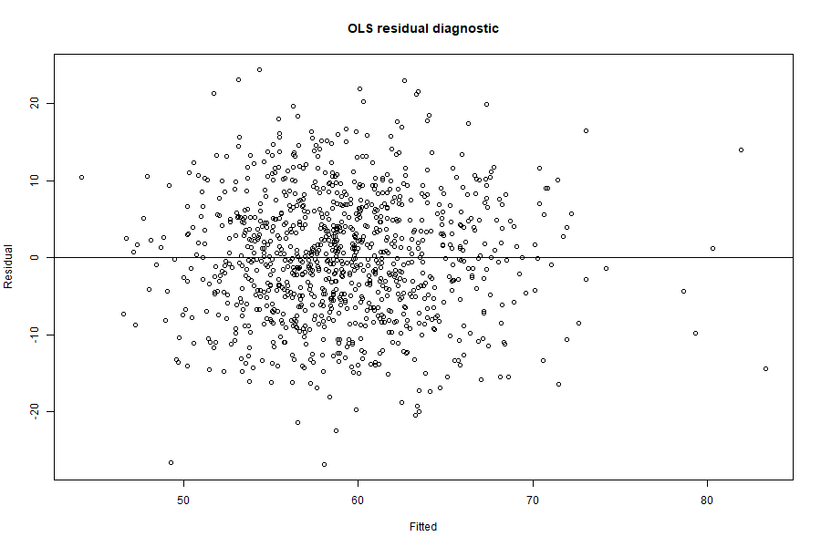

## 9. Matrix algebra

The least-squares solution can be found from $(X^TX)\hat{\beta}=X^Ty$. For the model with an intercept, study hours, and attendance, the largest difference from the statsmodels calculation was $4.48\times10^{-13}$.

**Worked example:** Let $A=\begin{bmatrix}1&2\\3&4\end{bmatrix}$ and $B=\begin{bmatrix}5&6\\7&8\end{bmatrix}$. Then $A+B=\begin{bmatrix}6&8\\10&12\end{bmatrix}$, $AB=\begin{bmatrix}19&22\\43&50\end{bmatrix}$, and $A^T=\begin{bmatrix}1&3\\2&4\end{bmatrix}$. The determinant of $A$ is $-2$, its inverse is $\begin{bmatrix}-2&1\\1.5&-0.5\end{bmatrix}$, and solving $A\mathbf{x}=\begin{bmatrix}5\\11\end{bmatrix}$ gives $\mathbf{x}=\begin{bmatrix}1\\2\end{bmatrix}$.

## 10. Eigenvalues, eigenvectors, and PCA

PCA combines several measures into new components. After standardizing study hours, attendance, age, and score, the eigenvalues were 1.445, 1.075, 0.970, and 0.514. The first two components explained 36.1% and 26.9% of the variation, or 63.0% together.

**Worked example:** For the diagonal matrix $\begin{bmatrix}3&0\\0&1\end{bmatrix}$, the eigenvalues are 3 and 1, and the matching directions are the two coordinate axes.

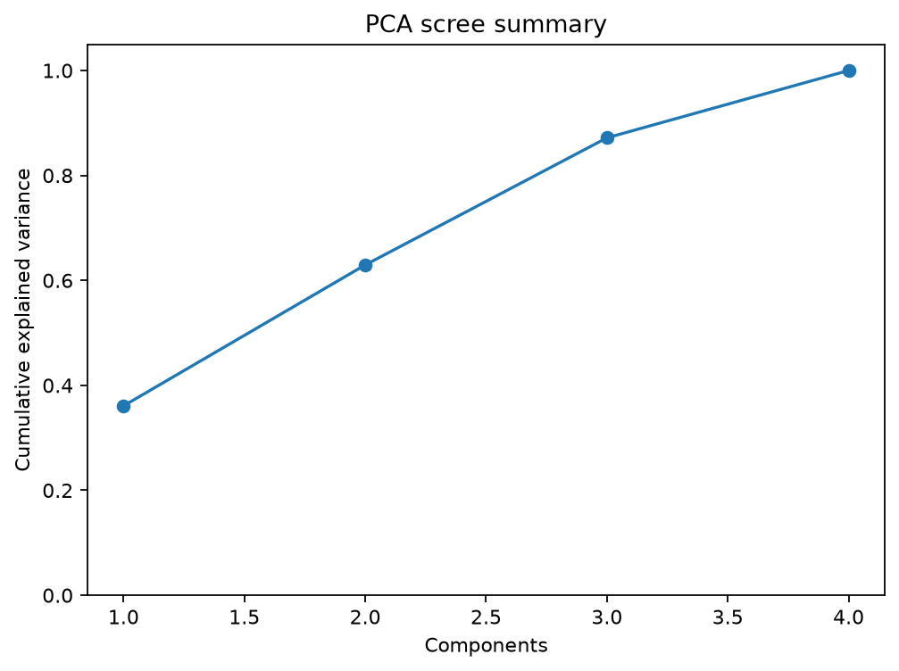
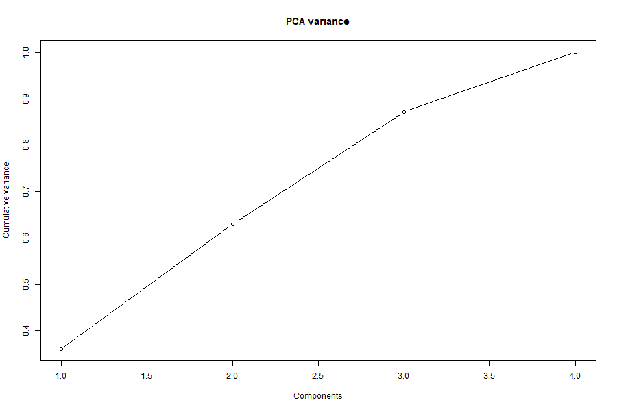

## 11. Numerical optimization

Optimization finds values that minimize or maximize a function. I used BFGS to find a line minimizing squared errors between score and study hours. It estimated an intercept of 52.68 and slope of 1.077; the optimizer reported convergence.

**Worked example:** For $f(x)=(x-3)^2$, the minimum is 0 at $x=3$.

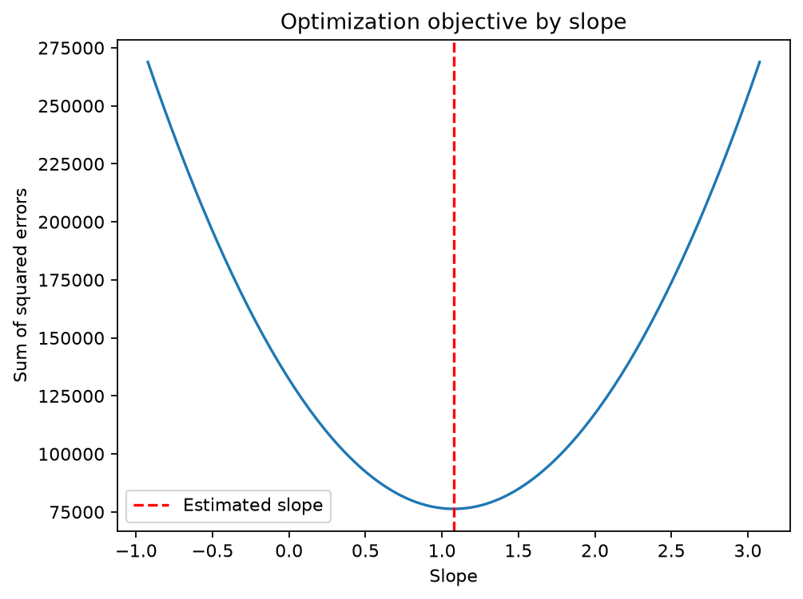

## 12. Random numbers and Monte Carlo

Monte Carlo estimation uses random samples. I drew 500,000 points uniformly from the square $[-1,1]^2$ and counted those inside the unit circle. The estimate $\hat{\pi}=4M/N$ was 3.1434, with estimated standard error 0.00232.

**Worked example:** If 25 of 100 simulated points land in an event, its estimated probability is $25/100=0.25$.

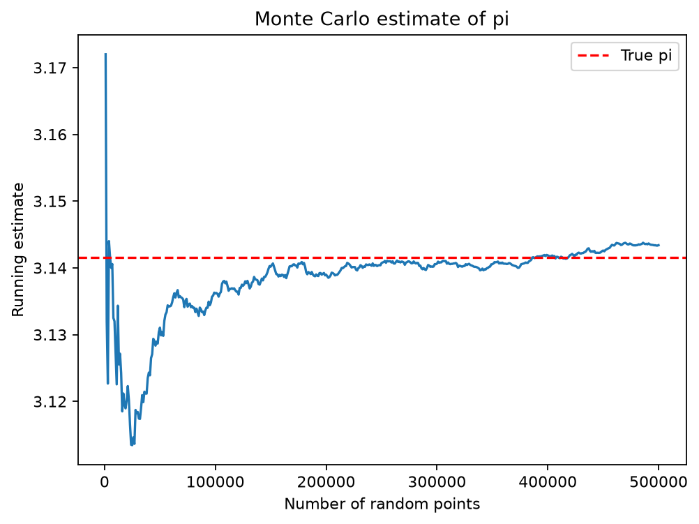

## 13. Time-series analysis

The 60-month synthetic series has an upward trend and a repeating yearly pattern. Its estimated trend was 1.636 units per month and lag-one autocorrelation was 0.949. I used additive seasonal decomposition and Holt-Winters to make a 12-month demonstration forecast. The forecast rises overall and follows the yearly pattern; for example, the first three predicted values were 304.58, 314.62, and 321.30. These are not real enrollment estimates. All 12 values are in `results/13_monthly_forecast.csv`.

**Worked example:** For monthly values 10, 12, 14, a simple one-step forecast using the latest value is 14.

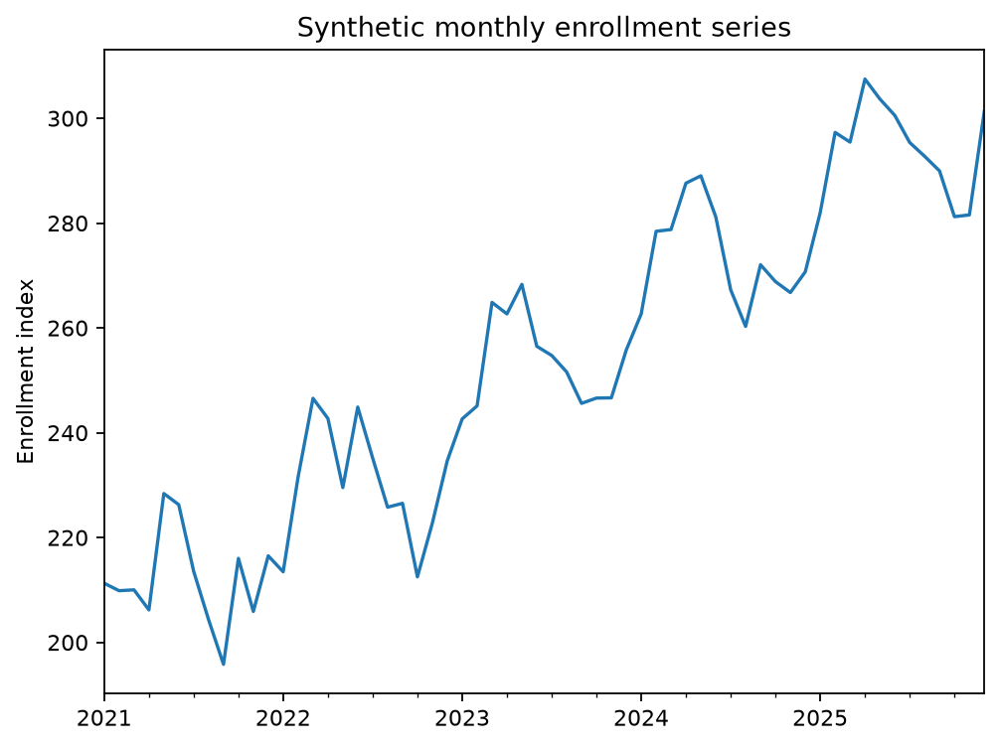
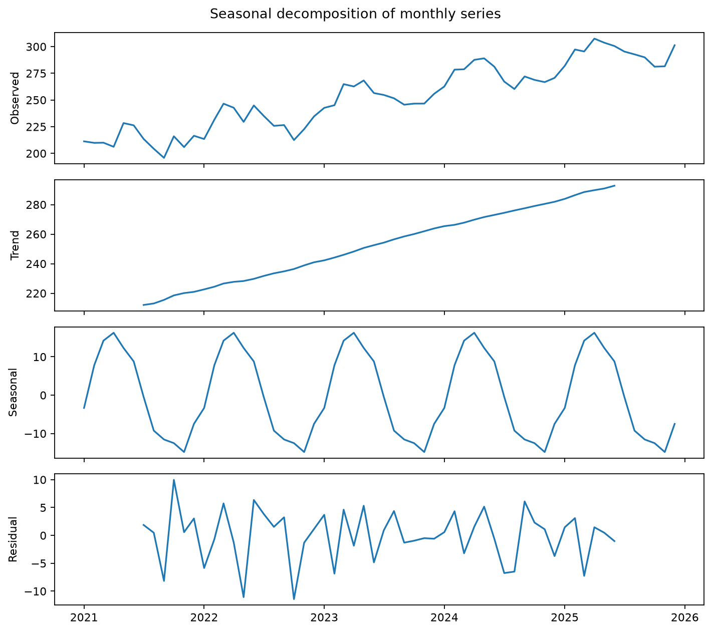
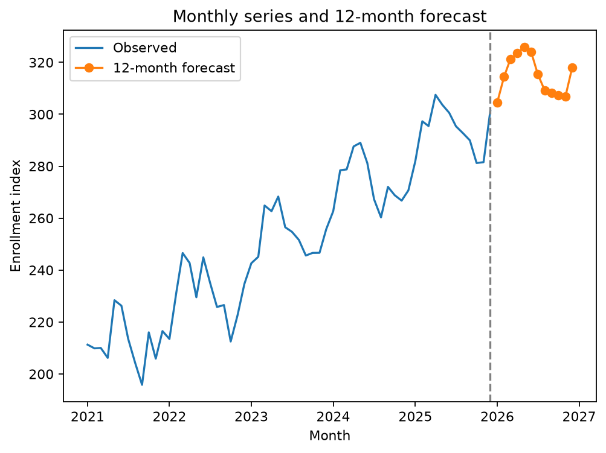
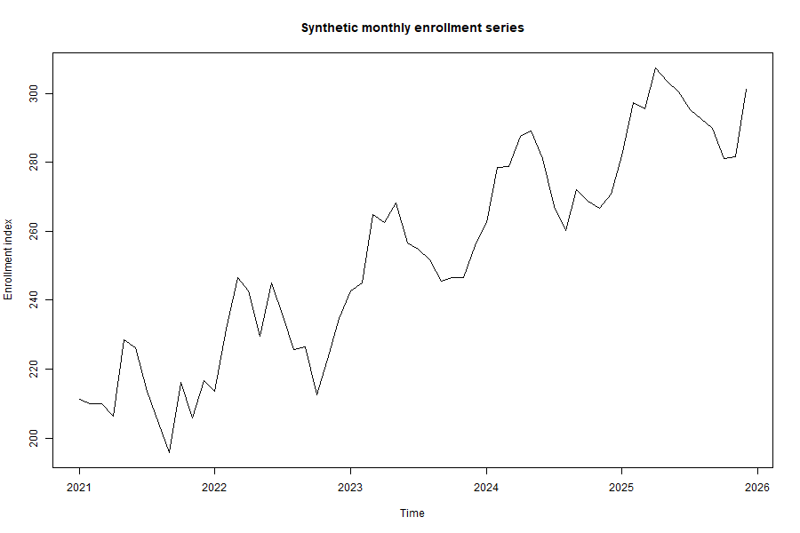

## 14. Statistical charts

I used histograms and a boxplot to show score distributions (Topic 1), scatter plots to show relationships (Topics 7 and 14), and line charts for Monte Carlo convergence and the monthly series and forecast (Topics 12 and 13). These match the histogram, boxplot, scatter plot, and line graph types in the assignment brief. Charts help show patterns and unusual values; they do not replace checking the data and method.

**Worked example:** If points on a scatter plot move upward from left to right, the two measures have a positive association.

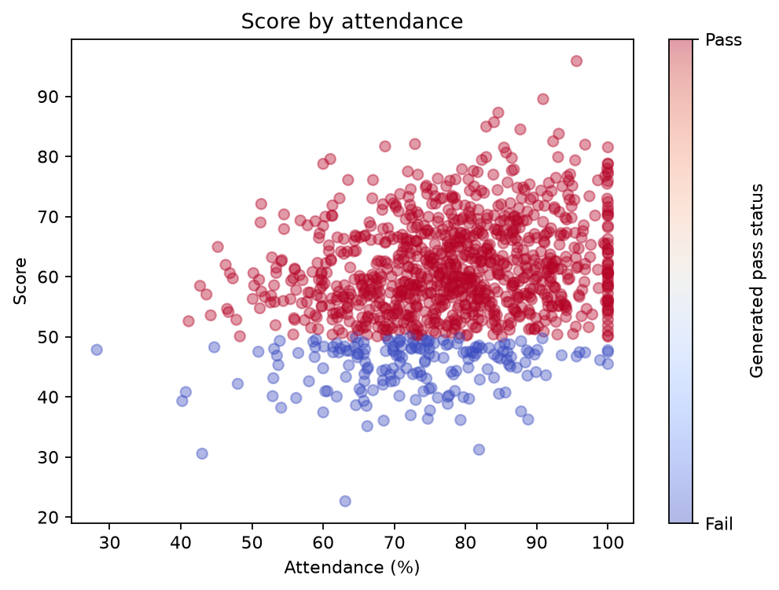
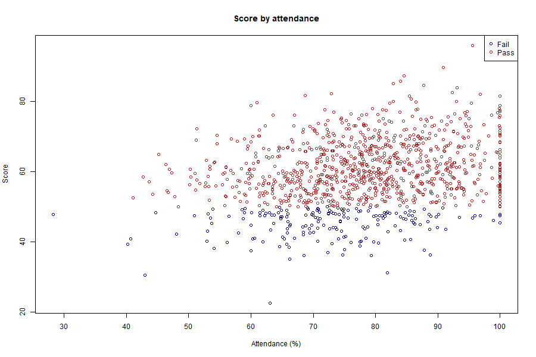

## 15. Data transformation and normalization

A z-score is $z=(x-\bar{x})/s$. It measures distance from the mean in standard deviation units. The generated raw score mean and sample SD were 59.19 and 9.56. After z-scoring, the mean was approximately 0 and the sample SD was 1. Min-max scaled scores ranged from 0 to 1.

**Worked example:** With mean 10 and SD 2, a value of 14 has z-score $(14-10)/2=2$.

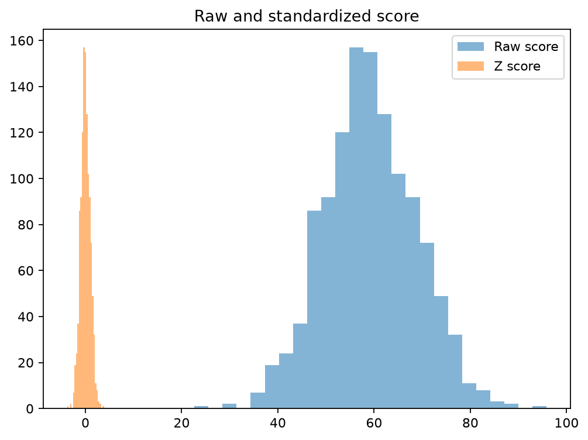

## 16. ANOVA and experimental design

One-way ANOVA compares means across three or more categories using $F=MS_{between}/MS_{within}$. The generated group means were A 58.82, B 61.09, and C 57.51. The test gave $F=15.02$ and $p=3.62\times10^{-7}$. Tukey's comparisons found A–B ($p=0.0019$) and B–C ($p<0.001$) differences; A–C was not significant ($p=0.127$). The categories are generated labels, not a real experiment.

**Worked example:** For A = {4, 5, 6}, B = {6, 7, 8}, and C = {8, 9, 10}, the group means are 5, 7, and 9, and the grand mean is 7. The between-group sum of squares is $SSB=3[(5-7)^2+(7-7)^2+(9-7)^2]=24$, so $MSB=24/2=12$. The within-group sum of squares is $SSW=2+2+2=6$, so $MSW=6/6=1$. Therefore, $F=MSB/MSW=12$.

## 17. Chi-square and categorical data

The chi-square test compares observed counts with counts expected under independence: $\chi^2=\sum(O-E)^2/E$. For category and pass status, the statistic was 8.914 with 2 degrees of freedom and $p=0.0116$. Each expected cell count was above 5. The table shows observed and expected failure/pass counts.

| Group | Observed fail | Observed pass | Expected fail | Expected pass |
| --- | ---: | ---: | ---: | ---: |
| A | 71 | 319 | 64.03 | 325.98 |
| B | 51 | 370 | 69.11 | 351.89 |
| C | 75 | 314 | 63.86 | 325.14 |

**Worked example:** If an observed count is 12 and its expected count is 10, its contribution is $(12-10)^2/10=0.4$.

## 18. Logistic regression

Logistic regression models a yes/no outcome using $\log[p/(1-p)]=\beta_0+X\beta$. With balanced class weights, the held-out accuracy was 58.7%, precision 87.9%, and recall 58.5%. Its confusion matrix was $[[25,17],[88,124]]$ with rows actual 0/1 and columns predicted 0/1. The always-pass baseline had 83.5% accuracy and 100% recall, but zero ability to identify failures. The comparison shows why accuracy alone is not enough. The odds ratio for study hours was 1.36 per additional hour, holding the other model inputs fixed.

**Worked example:** If the odds are 1 to 3, the probability is $1/(1+3)=0.25$.

## 19. Non-parametric methods

The Mann-Whitney test compares ranks for two independent groups. For the generated treatment labels, $U=216487.5$ and $p=1.13\times10^{-9}$. The medians were 60.52 for Workshop and 57.31 for Control.

**Worked example:** Let A = {1, 4} and B = {2, 3}. Their pooled ranks are 1, 4 for A and 2, 3 for B. A's rank sum is $R_A=1+4=5$. With $n_A=2$, $U_A=R_A-n_A(n_A+1)/2=5-2(3)/2=2$.

The Welch t-test also rejected equal means ($p=2.64\times10^{-10}$), as did the Mann–Whitney test ($p=1.13\times10^{-9}$). The t-test compares means, while Mann–Whitney compares ranks, so they do not test exactly the same thing.

## 20. Bootstrap and resampling

The bootstrap repeatedly samples from observed rows, allowing a row to appear more than once. Across 2,000 resamples, the mean-score standard error was 0.276 and the 95% percentile interval was 58.67 to 59.73.

**Worked example:** A bootstrap sample from [2, 4, 6] could be [2, 2, 6]; its mean is $10/3$.

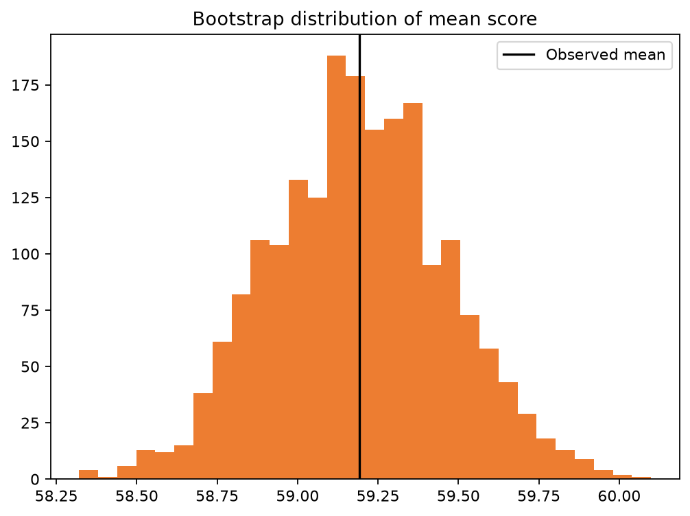
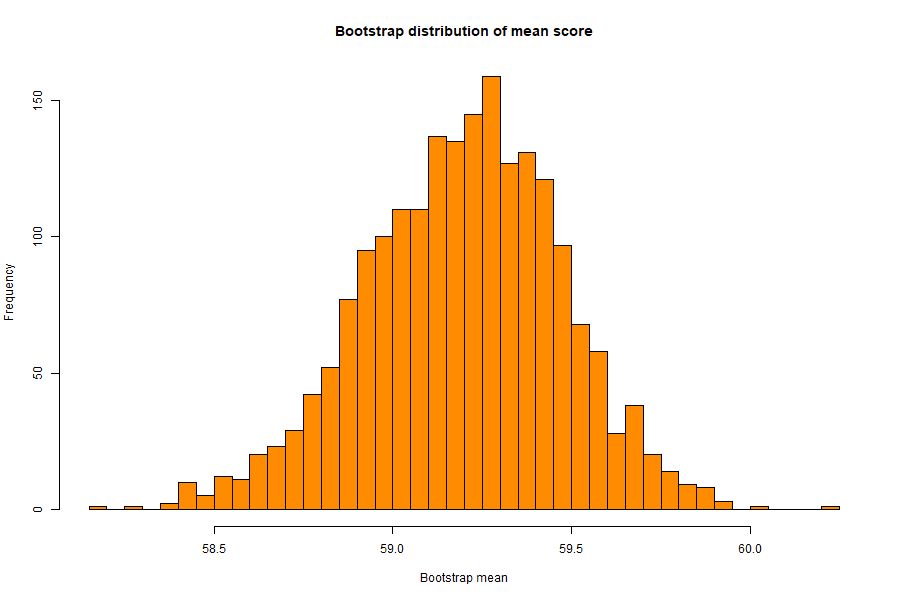

## 21. Multivariate analysis

I used covariance, PCA, and k-means on several measures. The first two principal components explained 63.0% of variation. In Python, the cluster sizes were 415, 217, and 382; in R, they were 230, 402, and 382. K-means can give different groupings from different starting points. I used fixed seeds so each script can repeat its own result. These groups are exploratory and are not confirmed real categories.

**Worked example:** A record with measures (height, weight) is multivariate because it contains two variables.

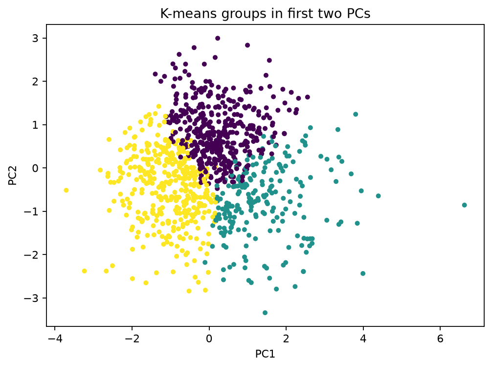

## 22. Missing data and imputation

Study hours and attendance each had 96 missing values (8%); 1,014 rows had both values. I filled missing values with their column medians. For study hours, mean/SD changed from 5.982/3.488 to 5.936/3.349. For attendance, it changed from 77.663/12.554 to 77.698/12.042. Imputation brings the missing values back into the data, but real data need checks on why values are missing and whether this method is suitable.

**Worked example:** For observed values [2, missing, 8], the median of observed values is 5, so median imputation gives [2, 5, 8].

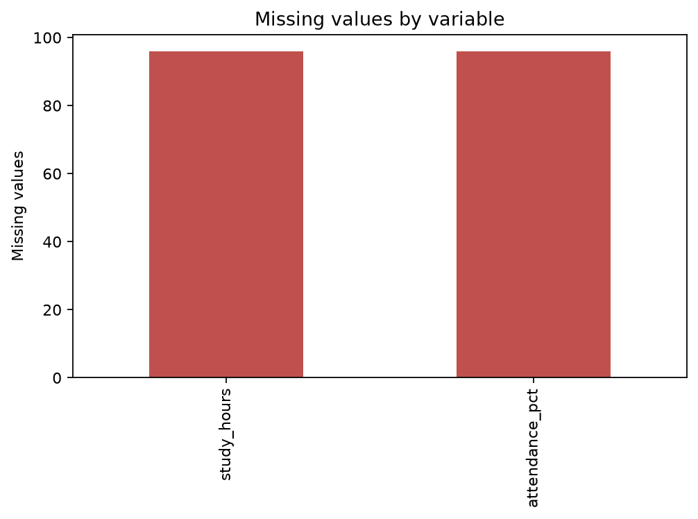
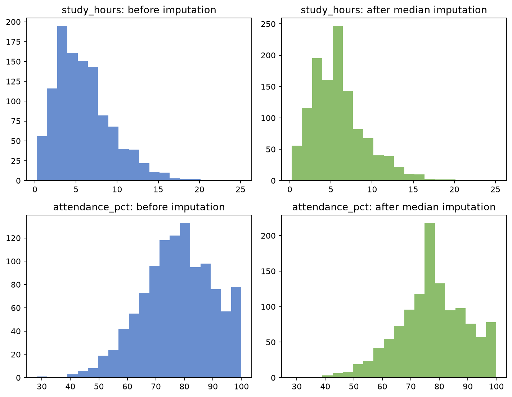

## 23. Statistical reporting and reproducibility

Both scripts use seed 4131. Python creates the synthetic data and monthly series; R reads those same files. The R linear model had an $R^2$ of 0.284, and its first two principal components explained 63.0% of the variation. The R logistic model had 84.6% accuracy on its test data, but it marked 37 generated failures as passes and missed 2 passes. R's 95% bootstrap interval for the mean score was 58.63 to 59.73. These results are from the same synthetic data, not real student records. I used Markdown because GitHub displays it beside the code; I did not need a Jupyter notebook or R Markdown for these scripts. Python results are in `results/all_results.json` and `results/summary.csv`; R results are in `results/R_all_results.txt` and `results/R_summary.csv`.

**Worked example:** Setting a random seed before a simulation makes the same pseudo-random sequence repeat when the same software and settings are used.

## References

- BIT 4131 Statistical Computing and Reporting assignment brief.
- Python, NumPy, pandas, SciPy, scikit-learn, and statsmodels documentation: [Python](https://docs.python.org/3/), [NumPy](https://numpy.org/doc/), [pandas](https://pandas.pydata.org/docs/), [SciPy](https://docs.scipy.org/doc/scipy/), [scikit-learn](https://scikit-learn.org/stable/user_guide.html), and [statsmodels](https://www.statsmodels.org/stable/user-guide.html).
- R documentation: [The R Project](https://www.r-project.org/) and [R manuals](https://cran.r-project.org/manuals.html).
